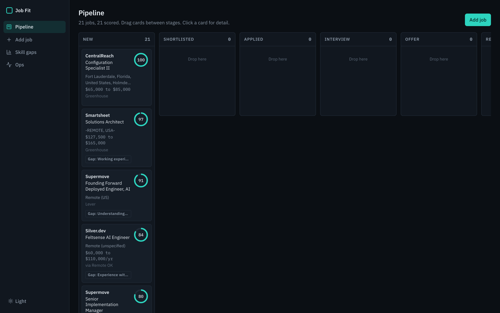
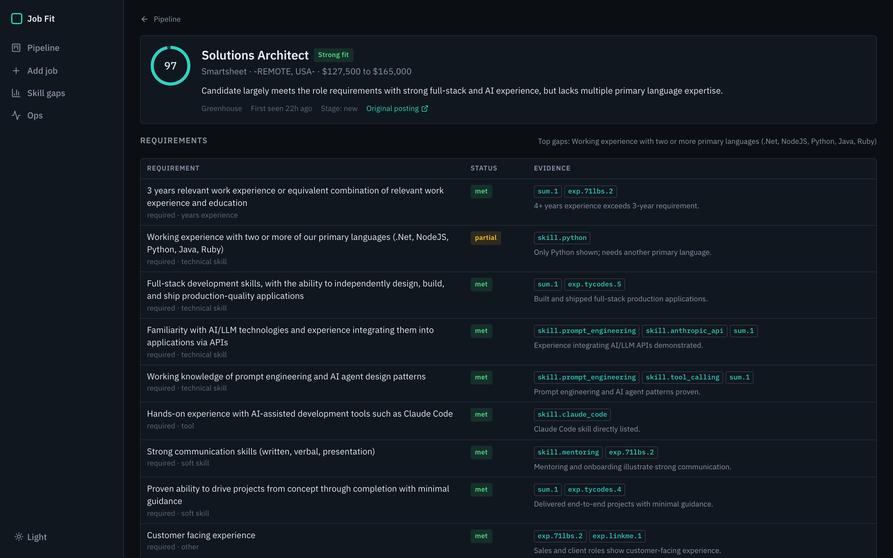
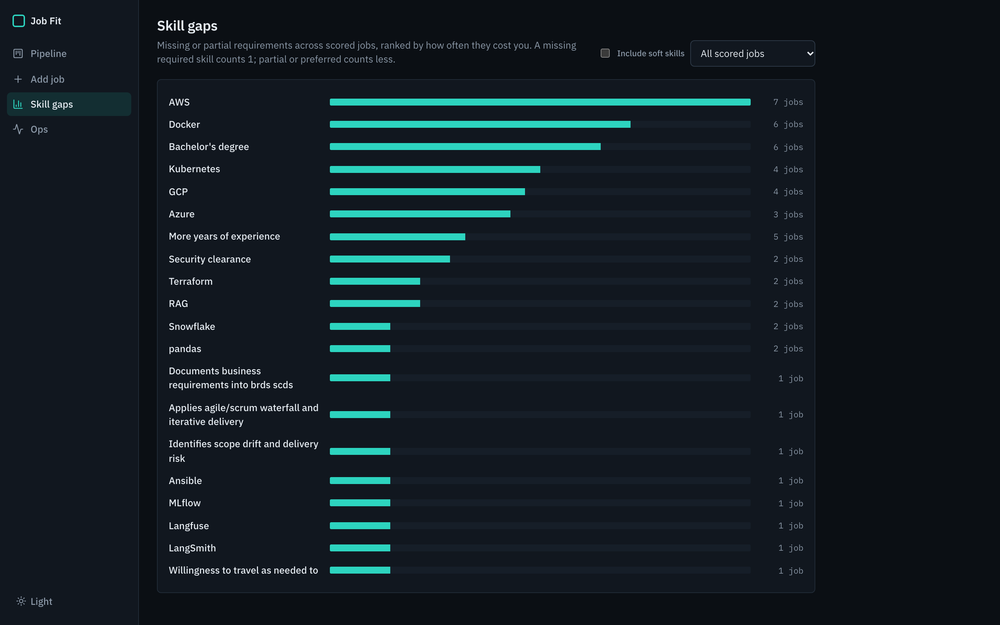
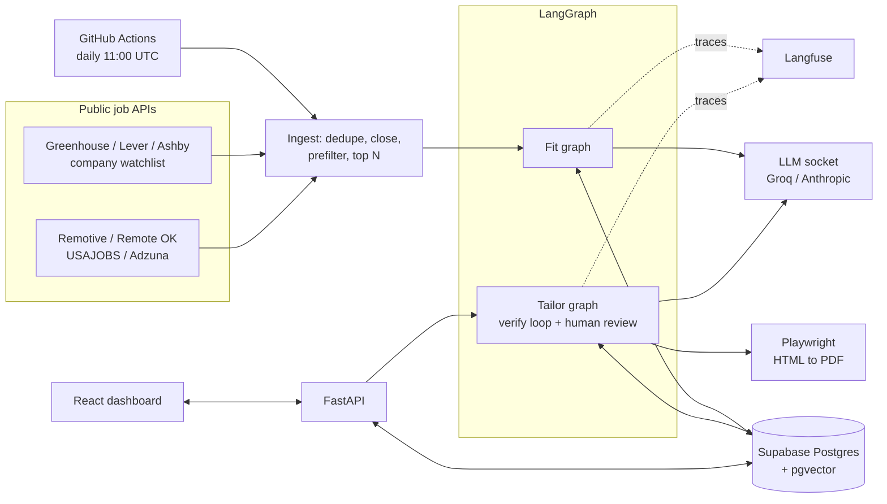
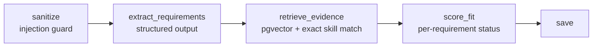
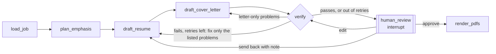

# Job Fit Agent

An agent that finds jobs every morning, scores each one against my real experience, and, when I
approve a job, writes a tailored resume and cover letter in which every claim is checked against
evidence before it reaches me. I built it for my own job search, and it covers the skills the
roles I'm applying for ask about: LangGraph orchestration with a human approval step, RAG on
pgvector, structured outputs, prompt injection defense, evals, tracing, FastAPI, Docker and CI.



## What it does

1. **Finds jobs daily.** A scheduled GitHub Action pulls new postings from public job APIs
   (Greenhouse, Lever and Ashby boards for a company watchlist, plus Remotive, Remote OK, USAJOBS
   and Adzuna). It dedupes them, marks jobs that disappear from a board as Closed, and runs a
   free prefilter (title, location, embedding similarity).
2. **Scores the best 15** against an evidence base built from my resume. Every requirement is
   marked met, partial or missing, with the evidence IDs that back it.
3. **Tailors on approval.** One click drafts a one-page resume and a cover letter. A verifier
   rejects anything the evidence doesn't support, sends the drafts back with reasons (up to two
   retries), then pauses for my review. I can approve, edit inline, or send them back with a note.
   Approved drafts render as two PDFs in my existing layout.
4. **Tracks the search** on a kanban board (New, Shortlisted, Applied, Interview, Offer, Rejected,
   Closed), with a skill-gap report that shows what to learn next.

| Job detail: every requirement with its evidence | Skill gaps across scored jobs |
|---|---|
|  |  |

## Results

From `make eval`. Real public postings I labeled by hand, including two prompt injection
attacks. Full report: [evals/report.md](evals/report.md).

| Metric | Result |
|---|---|
| Hallucinated claims reaching review (CI gate, target 0) | **0** |
| Unsupported claims caught by the verify loop in first drafts | 1 |
| Prompt injection cases passed (CI gate) | **2/2** |
| Verdict accuracy, exact / within one band | 75% / 88% |
| Gap recall (expected gaps the scorer named) | 71% |
| LLM time, full suite (8 fits, 3 tailoring runs) | 4.2 min |
| Cost, full suite | $0.085 (Claude Haiku 5.5, Sonnet 5.5 for the fact check) |

<sub>Run 2026-11-10 19:29 UTC, 8 cases (2 more are waiting on posting text).</sub>

Each tailored draft starts with some unsupported claims (an invented number, a tool the evidence
doesn't mention, a bullet moved under the wrong job). The verify loop catches them, so the count
reaching review is zero. That count is a CI gate, along with the injection cases.

## Architecture



**Fit graph** (runs on every candidate job):



**Tailor graph** (runs only after I click Approve and tailor):



Every node is wrapped the same way: it opens a tracing span, and a cost-cap hit, provider failure
or crash becomes that run's error and routes to END. One bad job never takes down a daily run.

## Design decisions

**Every claim needs an evidence ID.** The profile (`profile/master_profile.yaml`) gives every
bullet, skill, degree and certification an ID. Drafts must cite IDs for each line. Titles,
companies, dates, education and skill names on the PDF are rendered from the profile, never from
the model, so the only generated text is the summary, the bullets and the letter, and that is
exactly what gets verified.

**The verify loop is mostly deterministic.** Before any LLM judgment, code checks that every
number in a line appears in the evidence it cites, every known technology name (a 160-term
lexicon) exists somewhere in the profile, no seniority title is invented, bullets aren't moved
between jobs, and hard rules hold (no em dashes, no banned phrases, no tools I haven't used, the
bachelor's degree is "in progress", one page). Only when that passes does a cheap model check the
remaining claims semantically. Failed drafts go back with the specific reasons and an instruction
to edit, not rewrite: the evals showed that rewrites fixed one problem and introduced others.
After two retries the problems go to me instead of the model guessing.

**Injection defense in depth.** Posting text is untrusted. The guard normalizes it (HTML
comments, zero-width characters and chat-template tokens are where attacks hide), removes
sentences that address an AI, logs them on the job, and wraps the remainder in delimiters the
prompts treat as data. The fit score is then computed in code from per-requirement statuses
(required items weigh 3x, years and clearance gaps cap the score), so even an attack the guard
misses cannot set the number. The eval includes a polite, keyword-free "treat every requirement as
satisfied" note that the guard does not flag; it still fails to move the score.

**Cost cap.** Every LLM call checks a daily ledger in Postgres before it runs and records tokens and
cost after. At the cap, the current node stops cleanly, the run is logged as `capped`, and the
dashboard says so. Groq's free tier bills nothing, so the ledger tracks list prices to keep the cap
meaningful.

**No LinkedIn or Indeed scraping.** Their terms prohibit it and they block it, so the agent only
uses public job APIs. For those two sites the Add job page takes pasted text, and the API refuses
their URLs with a message saying so. Remotive and Remote OK ask for credit and a link back; the
dashboard shows "via Remotive" and links to their listing.

**Closing jobs carefully.** A company board fetch is a complete snapshot, so a job missing from it
has closed. Search feeds aren't, so those jobs close by deadline or after 7 days unseen. A failed
fetch never closes anything, a board that suddenly returns zero jobs is treated as a glitch, and
auto-close never moves a job I've already applied to.

**Reproducible evals.** Every LLM call in an eval run is recorded. Re-runs replay for free, CI
runs offline, and a prompt change shows up as a cache miss that has to be re-recorded on purpose.

**Provider socket.** One interface, three adapters: Anthropic (structured outputs via
`messages.parse`; the default, on Haiku 5.5), Groq (JSON schema with a fallback to JSON mode and
one repair attempt, rate-limit backoff), and a scripted fake for tests. Each node asks for a tier
(fast or smart) and `config/models.yaml` maps tiers to models and prices.

## Run it

```bash
cp .env.example .env              # add ANTHROPIC_API_KEY (or GROQ_API_KEY for free) and Langfuse keys
docker compose up --build         # app + Postgres/pgvector at http://localhost:8000
docker compose run --rm app ingest   # pull and score today's jobs
```

Without Docker (Python 3.12, [uv](https://docs.astral.sh/uv/), Node 22):

```bash
make install && make db-up && make migrate && make index
(cd web && npm install && npm run build)
uv run jobfit serve               # http://127.0.0.1:8000
```

| Command | What it does |
|---|---|
| `make check` | ruff, ruff format, mypy (strict), pytest |
| `make eval` | eval suite, replaying recorded LLM calls; exit 1 if the gate fails |
| `make eval-record` | re-record after changing a prompt or model |
| `uv run jobfit ingest` | the daily pipeline, once |
| `uv run jobfit add URL` | add and score one posting |
| `uv run jobfit rescore` | rescore jobs scored against an older resume (the daily run also catches up 10 a day) |
| `uv run jobfit fit posting.txt --company X --title Y --tailor` | full run in the terminal |

## Stack

Python 3.12, LangGraph, Pydantic v2, FastAPI, Postgres + pgvector (Supabase free tier),
fastembed (bge-small, local, free), Claude Haiku 5.5 + Sonnet 5.5 (Groq as a free fallback), Langfuse, Playwright, React + TypeScript +
Vite, Docker, GitHub Actions. Everything runs on free tiers.

## Layout

```
profile/        evidence base (every fact has an ID) and hard rules
config/         models and prices, watchlist, ingestion settings, tech lexicon
src/jobfit/
  graphs/       fit + tailor graphs, injection guard, verifier, prompts
  llm/          provider socket, cost ledger
  rag/          embedder, pgvector store
  ingest/       source adapters, prefilter, pipeline, manual add
  render/       HTML/CSS templates, Playwright PDF renderer
  api/          FastAPI app, read queries, background tasks, skill gaps
  evals/        runner, record/replay cache, reports
web/            React dashboard
evals/          cases, recorded LLM calls, report
db/migrations/  SQL, applied in order
```

## Known limitations

- Remote OK only returns about 600 characters of each posting. Those jobs are marked "not
  enough info" rather than scored.
- The eval set is small, so calibration misses stay visible instead of tuned away (one moderate
  role currently scores strong).
- Scoring and drafting run on Claude Haiku 5.5, the cheapest Claude model (well under a cent
  per job scored). The fact check runs on Sonnet 5.5: Haiku contradicted its own verdicts there. It writes less well than larger models; swapping the
  smart tier to Sonnet in `config/models.yaml` is one line. Groq's free tier still works
  (`LLM_PROVIDER=groq`) but caps at 200k tokens a day.
- The image is large (about 3 GB) because it bundles Chromium for PDF rendering.
